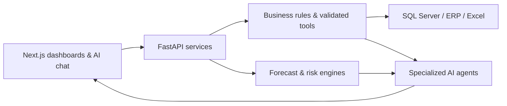

✦ EXIR Intelligence Platform
Enterprise data. Actionable intelligence. Smarter decisions.
An AI-powered command center for finance, sales, treasury, and business operations.
    
Overview · Modules · Screenshots · Architecture · Roadmap

✨ Overview
EXIR Intelligence Platform brings fragmented enterprise data into one intelligent workspace. It connects ERP and SQL Server systems to operational dashboards, business-rule engines, forecasting services, and AI-assisted analysis — helping teams move from what happened to what needs attention next.

Built around real finance and treasury workflows, the platform is expanding toward a unified view of sales and business operations.
🧩 What it does
Area	Highlights
📊 Management Command Center	KPI dashboards, management summaries, operational alerts, and drill-down views
💳 Treasury & Finance	Account balances, receipts, payments, issued/received cheques, due dates, and cash/bank movements
📈 Cash Flow & Forecasting	Expected inflows/outflows, liquidity scenarios, and explainable rule-based estimates
🤝 Customer & Collections	Customer exposure, overdue balances, payment behavior, and collection prioritization
🛍️ Sales Intelligence	Sales reporting, customer and product views, and performance analysis
🔎 Reconciliation & Reports	Bank/ERP reconciliation workflows, exception review, and report viewing
🤖 AI Assistant	Tool-driven access to validated business data, natural-language explanations, and decision support

Design principle: Financial figures are calculated by backend services and explicit business rules. AI agents interpret validated results rather than inventing numbers.

🖥️ Platform preview
<!-- Add actual screenshots to docs/images/ with the filenames below. Remove these comments once images are uploaded. -->Management dashboard	Treasury intelligence
	

Sales intelligence	AI assistant
	

📷 Screenshot slots are placeholders until real application captures are uploaded. Use demo or redacted data only — never expose customer or financial records.
🏗️ Architecture

Stack: Python · FastAPI · Next.js / React · Microsoft SQL Server · ERP integrations · Excel · LLM tool calling · modular services.

Engineering approach: Read-only enterprise data access where appropriate, deterministic financial calculations, controlled agent tools, and human review for consequential business actions.
🚀 Roadmap
Current focus: Treasury dashboards, cheque tracking, customer intelligence, sales views, reconciliation workflows, and explainable forecasts.

Evolving: Automated alerts, historical comparisons, richer agent orchestration, and safer ad-hoc enterprise queries.

Long-term vision: Extend the same intelligence layer to warehouse, production, planning, procurement, HR, marketing, and other departments.

From enterprise data to confident decisions.
EXIR Intelligence Platform · Built for practical, explainable enterprise AI.

