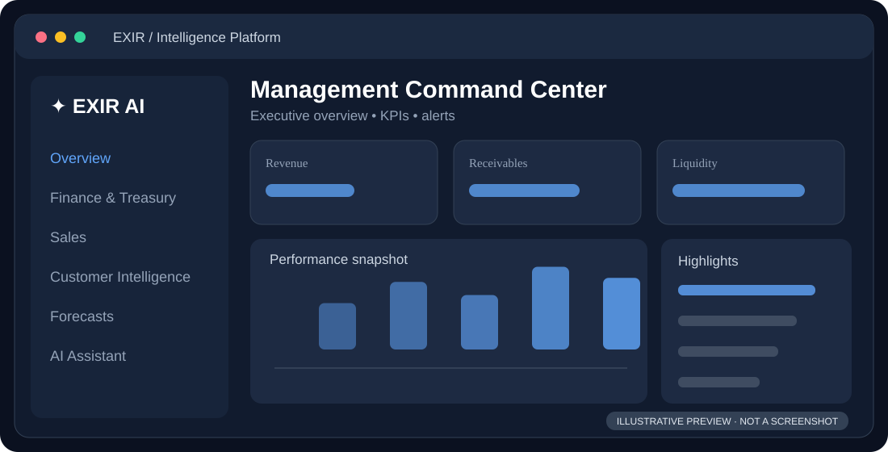
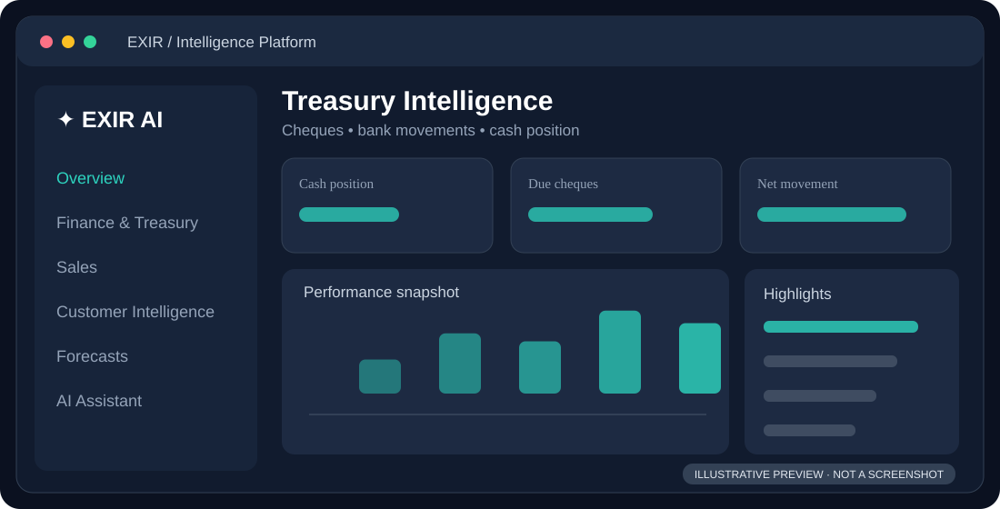
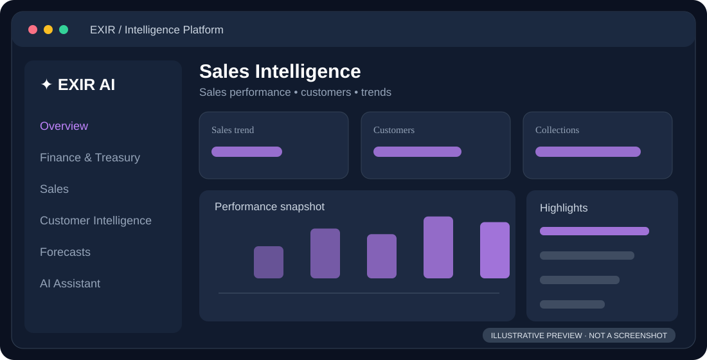
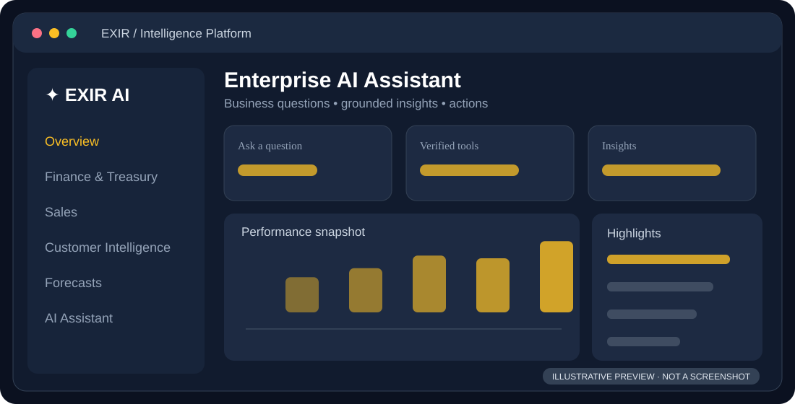
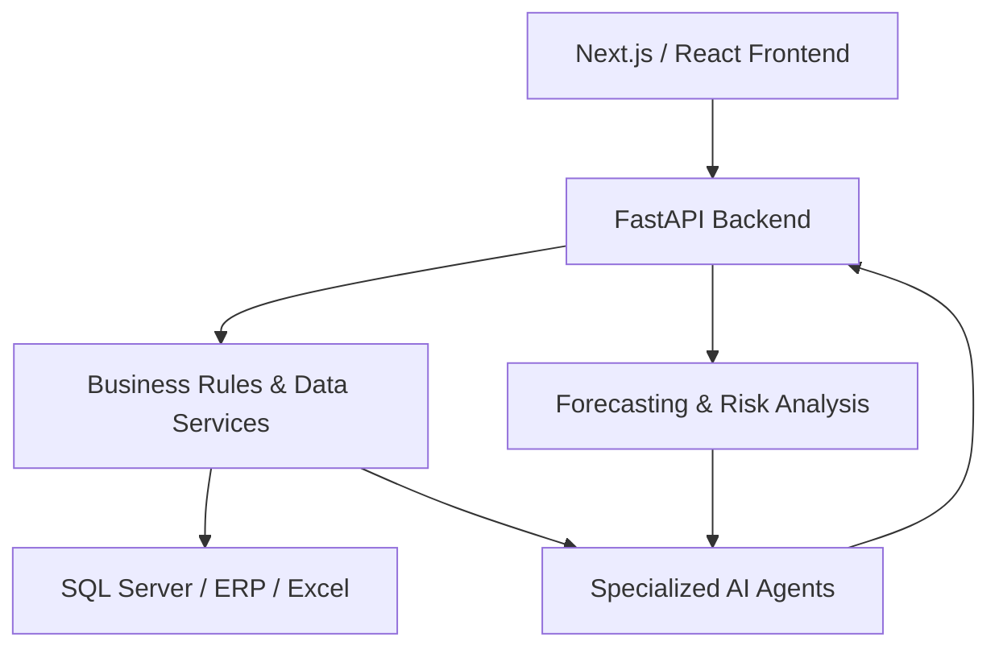

# ✦ EXIR Intelligence Platform

### Enterprise Data. Actionable Intelligence. Smarter Decisions.

**An AI-powered command center for Finance, Treasury, Sales, and Enterprise Operations.**

**[Overview](#-overview) · [Modules](#-core-modules) · [Screenshots](#-platform-preview) · [Architecture](#-architecture) · [Roadmap](#-roadmap)**

---

## ✨ Overview

**EXIR Intelligence Platform** transforms fragmented enterprise data into actionable business intelligence.

By connecting ERP systems, Microsoft SQL Server, financial workflows, analytics dashboards, and AI-powered agents, the platform enables organizations to monitor operations, identify risks, and make informed decisions.

> From enterprise data to intelligent decisions.

---

## 🧩 Core Modules

| Module | Capabilities |
|---|---|
| 📊 **Management Command Center** | Executive KPIs, management summaries, alerts, and drill-down analytics |
| 💳 **Finance & Treasury** | Account balances, receipts, payments, cheque tracking, and due dates |
| 📈 **Cash Flow Forecasting** | Liquidity projections, expected inflows/outflows, and financial scenarios |
| 🤝 **Customer Intelligence** | Customer balances, payment behavior, overdue accounts, and collection insights |
| 🛍️ **Sales Intelligence** | Sales performance, customer analysis, and operational reporting |
| 🔎 **Bank Reconciliation** | Bank statement processing, ERP reconciliation, and exception detection |
| 🤖 **AI Assistant** | Natural-language interaction with validated enterprise data and business tools |

**Design principle:** Financial calculations are performed through validated backend services and explicit business rules. AI agents provide interpretation and decision support.

---

## 🖥️ Platform Preview

A visual overview of the platform's core modules.

### 📊 Management Command Center

Executive dashboards, financial KPIs, business alerts, and management insights.

### 💳 Finance & Treasury Intelligence

Monitor cash positions, payments, receivables, cheques, and financial operations.

### 📈 Sales Intelligence

Explore sales performance, customer trends, and business analytics.

### 🤖 AI-Powered Assistant

Ask business questions in natural language and receive explanations grounded in validated data.

> **Note:** Preview illustrations are conceptual. Replace them with actual application screenshots when available. Avoid publishing confidential financial or customer information.

---

## 🏗️ Architecture

### Technology Stack

| Layer | Technologies |
|---|---|
| Frontend | Next.js, React, JavaScript / TypeScript |
| Backend | Python, FastAPI |
| Database | Microsoft SQL Server |
| Integrations | ERP systems, Excel |
| Intelligence | LLMs, tool calling, specialized AI agents |
| Analytics | Financial rules, forecasting, risk analysis |

---

## 🚀 Roadmap

**Current focus**
- Treasury and finance dashboards
- Cheque tracking and payment monitoring
- Customer and sales intelligence
- Bank reconciliation
- Explainable cash flow forecasts

**Next steps**
- Automated management alerts
- Historical performance comparisons
- Advanced AI agent orchestration
- Expanded enterprise analytics

**Long-term vision**

A unified intelligence platform connecting Finance, Sales, Warehouse, Production, Planning, HR, and other enterprise departments.

---

### ✦ From Enterprise Data to Confident Decisions

**EXIR Intelligence Platform**

*Built for practical, explainable enterprise AI.*

