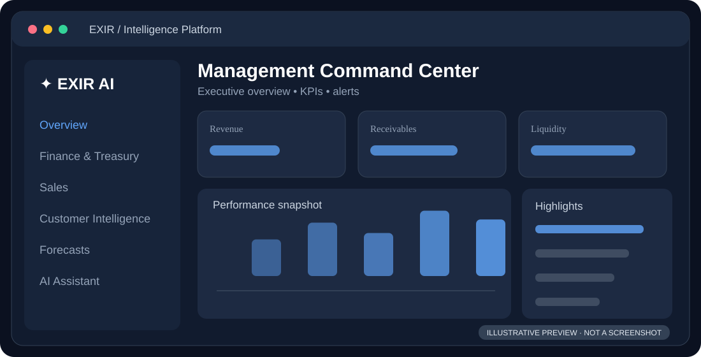
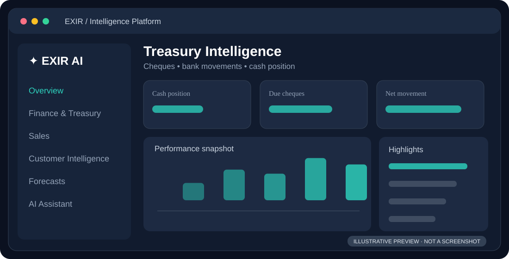
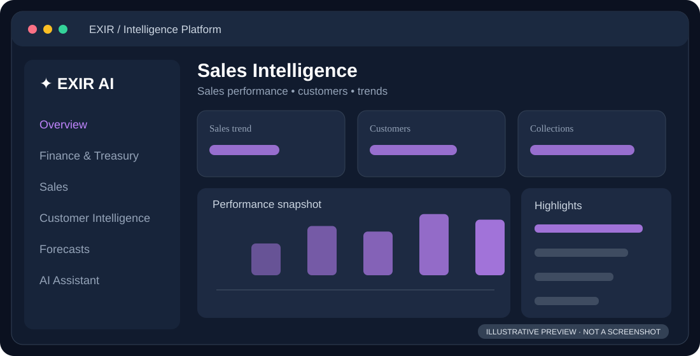
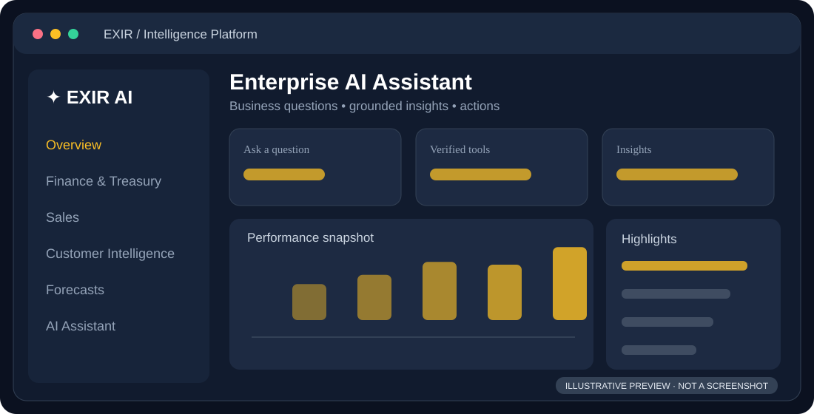
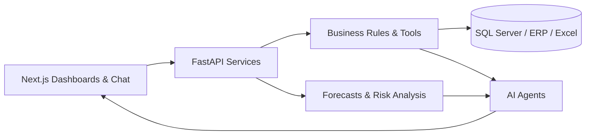

# ✦ EXIR Intelligence Platform

### From enterprise data to intelligent decisions.

**An AI-powered command center connecting finance, treasury, sales, and business intelligence.**

  
  
  
  
  

**[Explore the platform](#-inside-the-platform) · [Features](#-what-it-does) · [Architecture](#-how-it-works) · [Roadmap](#-whats-next)**

---

## ✨ One workspace. A clearer picture of the business.

**EXIR** brings ERP and SQL Server data into interactive dashboards, auditable business calculations, explainable forecasts, and AI-assisted insights. It is built around real enterprise workflows—not just a chatbot layered over reports.

## 🖥️ Inside the platform

> **Visual previews below are illustrative mockups, not real app screenshots.** Replace each `.svg` with an actual, redacted screenshot using the same filename (or update the paths). The README will display images directly on GitHub.

### Executive command center

### Finance & treasury

<table>
<tr><td width="50%"><strong>Sales intelligence</strong> </td><td width="50%"><strong>AI assistant</strong> </td></tr>
</table>

## ⚡ What it does

| Workspace | Key capabilities |
|:--|:--|
| 📊 **Management** | KPI summaries, operational alerts, drill-downs and decision support |
| 💳 **Finance & Treasury** | Balances, receipts, payments, cheque tracking and bank movements |
| 📉 **Liquidity & Forecasting** | Cash-flow scenarios, expected inflows/outflows and shortage signals |
| 🤝 **Customers & Collections** | Exposure, overdue balances, payment behavior and collection priorities |
| 🛍️ **Sales** | Sales performance, customer/product reporting and trends |
| 🔍 **Reconciliation** | Bank-to-ERP matching, exceptions and report review |
| 🤖 **AI Assistant** | Natural-language questions answered using controlled business tools |

## 🏗️ How it works

**Core stack:** Next.js / React · Python / FastAPI · Microsoft SQL Server · ERP integrations · Excel · LLM tool calling.

> **Trust by design:** Financial figures come from validated services and explicit rules. AI explains and prioritizes results; sensitive decisions remain subject to human review. Forecasts are explainable estimates, not claimed ML probabilities without a trained and validated model.

## 🧭 What's next

**Now:** Finance, treasury, cheque intelligence, customer insights, sales dashboards and reconciliation workflows.  
**Evolving:** Historical comparisons, proactive alerts, richer agent orchestration and controlled ad-hoc queries.  
**Vision:** Extend the intelligence layer to warehouse, production, planning, procurement, HR and marketing.

---

### Built to turn operational complexity into clarity.

**EXIR Intelligence Platform** · Enterprise AI with explainable business logic.

